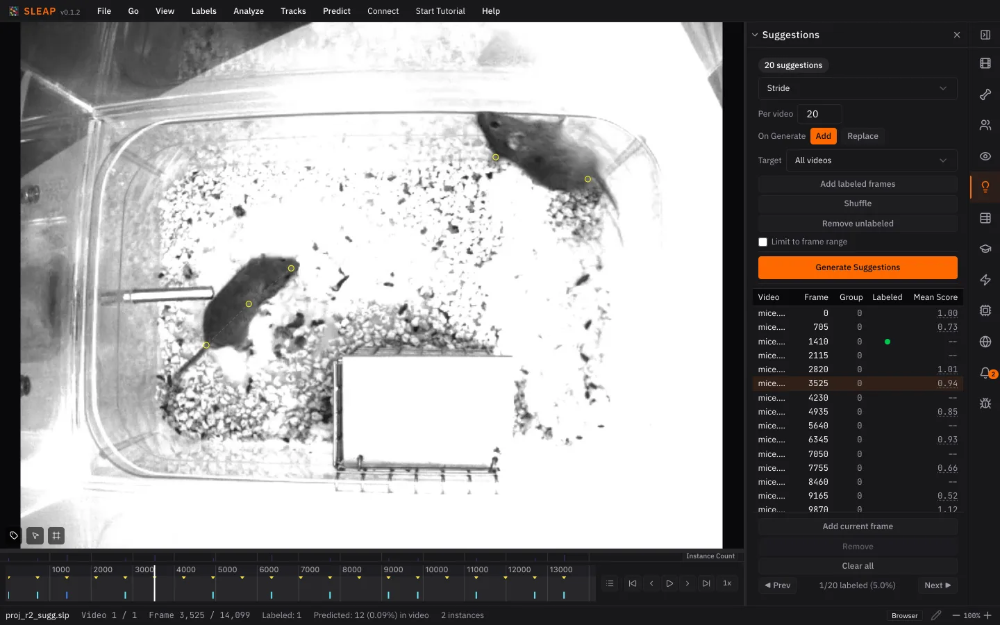

# 5. Correcting predictions

Expect rough predictions: the model learned from one frame. Correcting them is
how it improves. This loop of predict, correct and retrain is the core of SLEAP:
each model makes better predictions, so each round needs fewer corrections.

First, save a new version with **File ▸ Save As…** (++cmd+shift+s++ /
++ctrl+shift+s++). It suggests the next name, `labels.v002.slp`, so you keep
the earlier version.

## Correct

In the **Suggestions** panel, frames with a **Mean Score** have predictions. On a
few of them:

1. Accept the predictions: double-click a predicted instance, or press
   ++cmd+shift+a++ / ++ctrl+shift+a++ for every one on the frame.
2. Drag any nodes that are off.

Predicted nodes are yellow. An accepted node is red until you touch it, then
green, so you can see which nodes you've checked. Leaving a correct node red is
fine: an accepted instance counts as your label either way.

While you correct:

- **Label every mouse on the frame,** even one the model missed: add it with
  ++cmd+i++ / ++ctrl+i++. A frame with a missing animal teaches the model
  that the animal isn't there.
- **Don't guess hidden parts.** If you can't see a body part, mark it
  non-visible (hover over the node and press ++v++). A guessed point teaches
  the model to be confident where it shouldn't be.
- **Check nodes predicted as non-visible.** The model sometimes gets this
  wrong. Press ++v++ over the node to mark it visible again, then place it.

Correct at least two frames, then save. The more you correct, the better the
next model.

!!! tip "On a real project"

    Aim for 15–20 labeled frames before you retrain. Click the **Mean Score**
    column to sort by it, and correct frames from both ends: low scores are
    where the model struggles, and high scores can hide confident mistakes.

## Retrain

1. In the **Training** panel, click **Train Again**.
2. Keep the same settings, but raise **Max Epochs** to 50.
3. Click **Start Training**.

You don't have to wait for all 50 epochs: **Stop Early** keeps what's been
trained so far (click it once per model).

Repeat this correct-and-retrain loop until predictions rarely need fixing.

*Next up: [Tracking a new video](tracking.md)*
