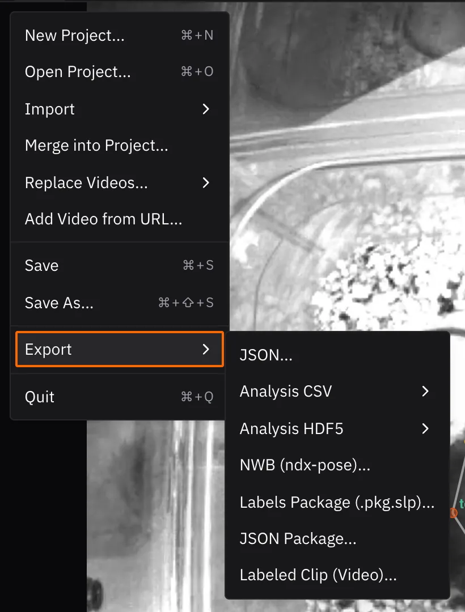

# 8. Exporting the results

A `.slp` file holds everything in your project: labels, predictions, tracks,
and the paths to your videos. That makes it the right format to keep working
in, but not to analyze: reading it takes SLEAP's tools. For analysis, export the
proofread poses to a plain format.

| Export | Menu | Gives you | Use it with |
|---|---|---|---|
| **Analysis CSV** | **File ▸ Export ▸ Analysis CSV ▸ Current Video…** | One row per animal per frame, with each node's x, y and score | Spreadsheets, pandas, R |
| **Analysis HDF5** | **File ▸ Export ▸ Analysis HDF5 ▸ Current Video…** | The same data as arrays, in SLEAP's `.h5` layout | MATLAB, NumPy |
| **NWB** | **File ▸ Export ▸ NWB (ndx-pose)…** (desktop) | Poses in the [Neurodata Without Borders](https://nwb.org) standard | Sharing and archiving |
| **Labeled clip** | **File ▸ Export ▸ Labeled Clip (Video)…** | An MP4 with the poses drawn on | Talks and figures |

Each analysis export also has **All Videos…**, for projects with several videos.

{ width="410" }

!!! tip "Sharing your data"

    NWB is the most portable choice: it's a standard for neuroscience data, and
    NWB files can be shared for free on the [DANDI Archive](https://dandiarchive.org).

## Reading poses in Python

You can also skip the export and read the `.slp` directly with
[sleap-io](https://io.sleap.ai) (`pip install sleap-io`):

```python
import sleap_io as sio

labels = sio.load_slp("labels.v003.slp")
poses = labels.numpy()  # shape: (frames, tracks, nodes, 2), NaN where missing

print([node.name for node in labels.skeleton.nodes])  # ['head', 'torso', 'tailbase']
print([track.name for track in labels.tracks])        # ['track_0', 'track_1']
```

sleap-io also converts between formats, such as COCO and DeepLabCut. See its
[formats documentation](https://io.sleap.ai/latest/formats/) and the
[File Formats](../reference/formats.md) reference.

*Next up: [What's next](next-steps.md)*
