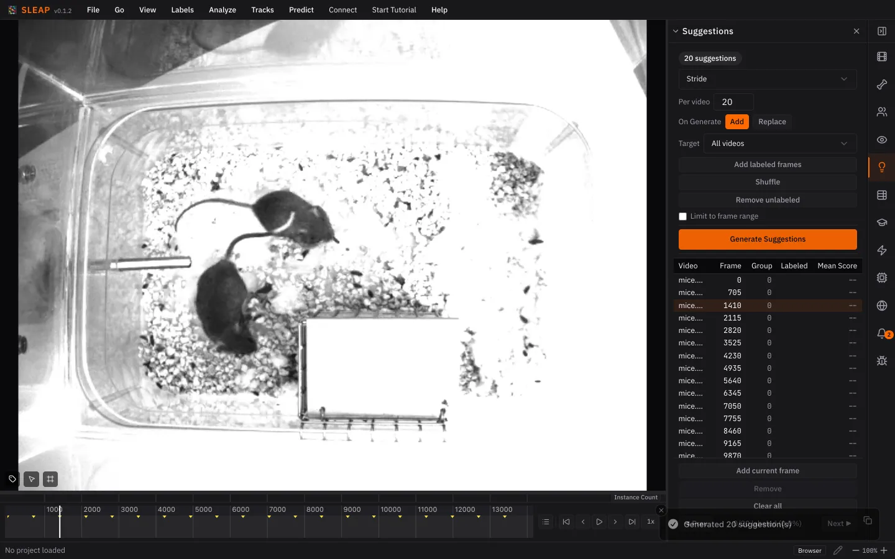
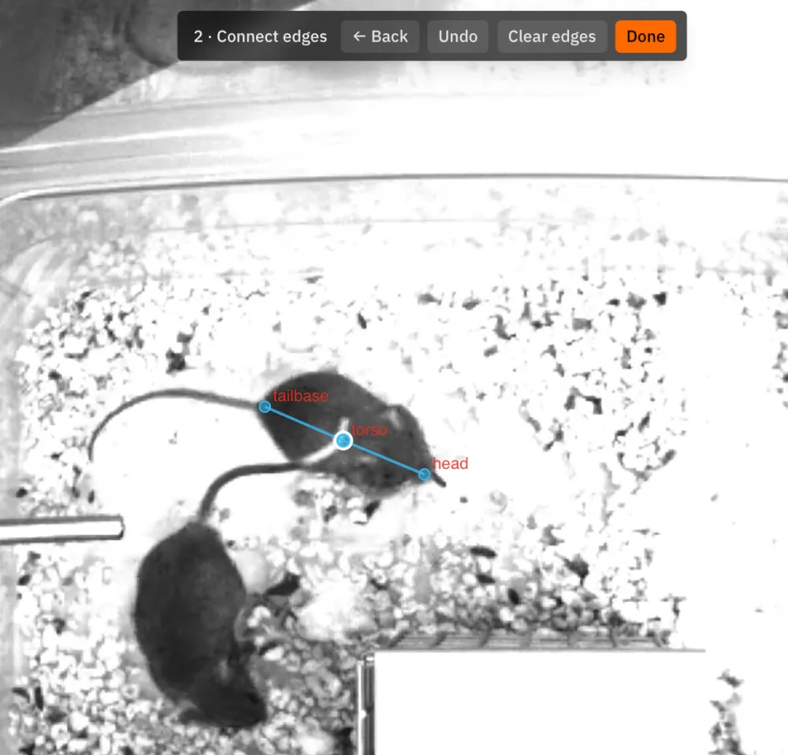
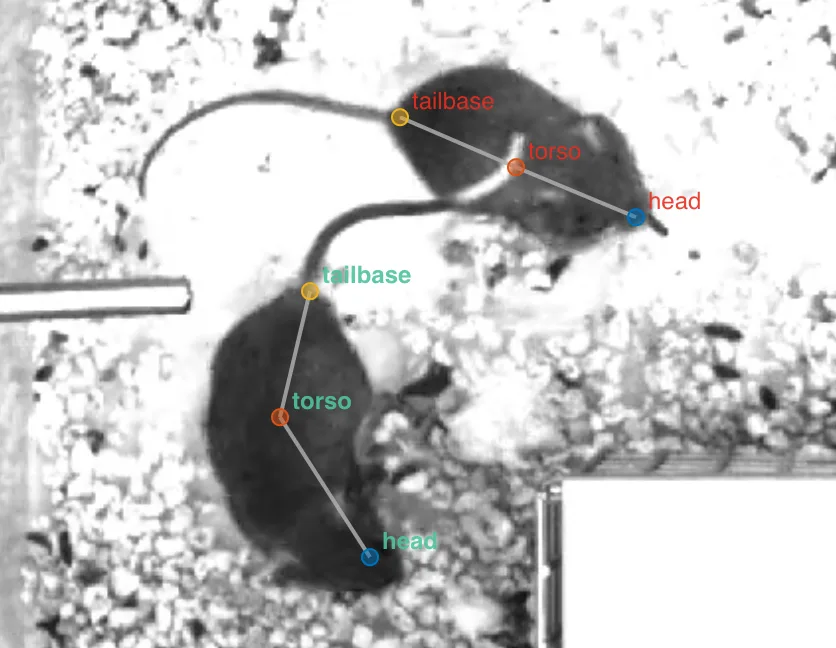

# 3. Initial labeling

## Generate suggestions

Suggestions are frames picked for you to label, spread across the video so your
labels cover all of it. Neighboring frames look almost the same, so labeling
frames in a row teaches the model little.[^methods]

1. Open the **Suggestions** panel.
2. Keep **Method: Stride** and **Per video: 20**, and click **Generate**.

## Draw the skeleton

A skeleton is the body parts you track (**nodes**) and the lines between them
(**edges**). For the mice, use three nodes: `head`, `torso`, and `tailbase`.

1. Go to frame **1410**, one of the suggested frames: ++cmd+j++ / ++ctrl+j++
   opens **Go to Frame**.
2. In the **Skeleton** panel, click **Draw skeleton on frame**.
3. Click on one mouse to place each node. Double-click a node to rename it.
4. Click **Next: Connect edges →**. Drag two strokes, each **starting at
   torso**: one to `head`, one to `tailbase`.
5. Click **Done**, then **Create instance**.

{ width="500" }

Draw the skeleton only once. It's a template: each mouse gets its own copy.

## Label the frame

An **instance** is one animal's copy of the skeleton. Label every mouse on
frame 1410:

- Drag the new instance's nodes onto the first mouse.
- For the second mouse, right-click the frame and choose
  **Add Instance ▸ Best** (or press ++cmd+i++ / ++ctrl+i++), then drag its
  nodes into place.
- If a body part is hidden, mark it non-visible: hover over the node and
  press ++v++.

{ width="420" }

Save with ++cmd+s++ / ++ctrl+s++, and save often as you label.

!!! tip "Labeling faster"

    - **Zoom:** hold ++ctrl++ and scroll (++ctrl++ on macOS too).
    - **Move a whole instance:** hold ++alt++ and drag any of its nodes, or
      press ++shift+a++ to select them all, then drag.
    - **Rotate an instance:** with it selected, hold ++alt++ and scroll.
    - **See nodes better:** **View ▸ Node Marker Size** makes nodes bigger, and
      **View ▸ Edge Style ▸ Wedge** shows which way each edge points.

!!! note

    One frame is enough to see the whole workflow. A real project needs more:
    label more suggested frames before you train for real.

See [Labeling Instances](../guides/labeling.md) for every labeling tool.

*Next up: [Training a model](training.md)*

[^methods]: **Stride** picks evenly spaced frames. Other methods pick frames
    at random, or group frames by how they look and pick from each group, so you
    label a visually diverse set. See [Suggestions](../guides/suggestions.md).
