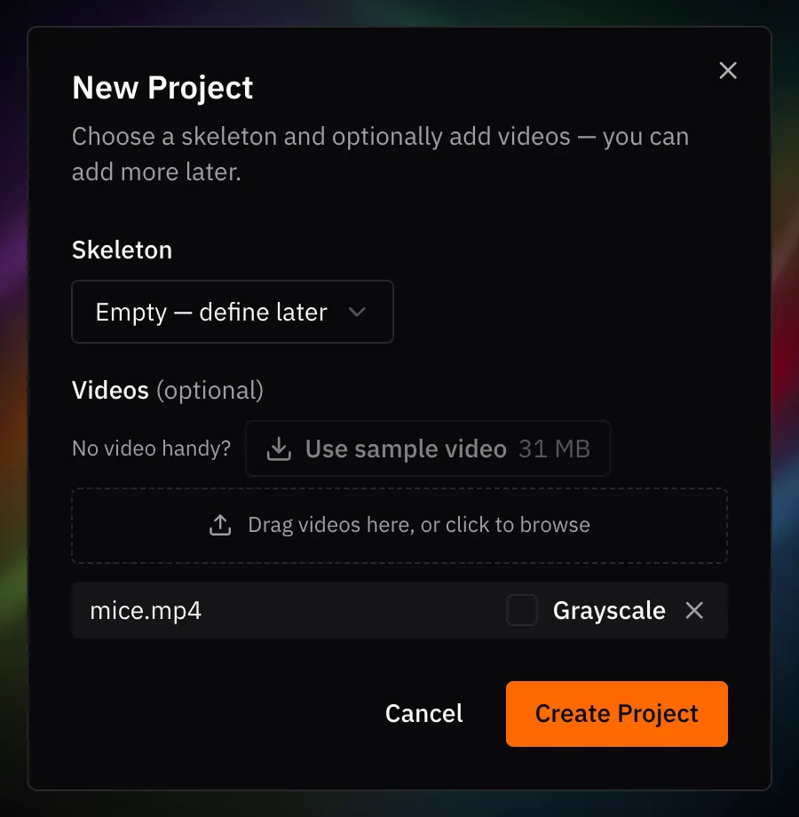

# 2. Create a project

1. On the Welcome screen, click **New Project** (or **File ▸ New Project…**).
2. Leave **Skeleton** on **Empty — define later**. You'll draw one in the next
   step.
3. Click **Use sample video**. It downloads `mice.mp4` and adds it to the list.
4. Click **Create Project**.
5. Save with ++cmd+s++ / ++ctrl+s++. The save dialog suggests
   `labels.v001.slp`.

{ width="450" }

A SLEAP project is a `.slp` file. It stores your labels and the *paths* to your
videos, not the videos themselves. To pick up where you left off, open it with
**File ▸ Open Project…**.

*Next up: [Initial labeling](initial-labeling.md)*
