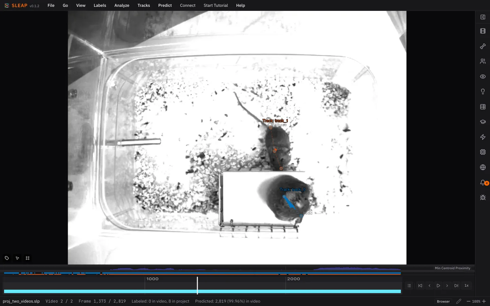

# 7. Proofreading

No automated tracker is perfect, so always check its output before analyzing it.
The most common error is an **identity swap**: two mice cross paths and their
tracks trade places. A single swap matters a lot, because every frame after it
carries the wrong identity.[^propagate]

## Set up the view

1. Turn on **View ▸ Color Predicted Instances**. Predictions are drawn yellow
   until you do.
2. Set **View ▸ Apply Distinct Colors To ▸ Tracks**, so each mouse is colored
   by its track.
3. Optionally, set **View ▸ Trail Length** to 50 to draw each mouse's recent
   path. A trail that jumps from one mouse to the other is a swap.

## Find swaps

- **Tracks ▸ Seekbar Header ▸ Min Centroid Proximity** plots how close the
  mice get. Dips are where they come close, which is where swaps happen.
- Step through those frames and watch for a color change on a mouse.
- ++cmd+e++ / ++ctrl+e++ jumps to the next frame where a new track appears,
  which usually means a track broke.

## Fix them

1. Turn on **Tracks ▸ Propagate Track Labels**, so a fix carries through to
   the end of the video.
2. Go to the first frame after the swap.
3. Press ++cmd+t++ / ++ctrl+t++ to swap the two mice's tracks back.

Save the result as a new version with **File ▸ Save As…**
(++cmd+shift+s++ / ++ctrl+shift+s++). Keeping the version from before
proofreading lets you compare the two later.

!!! tip "Check your labels too"

    [Label Quality Check](../guides/label-qc.md) flags labels that are probably
    wrong, such as left/right swaps and duplicates.
    [Instance Size Distribution](../guides/instance-size.md) shows how big your
    animals are, which helps you pick a crop size for top-down models.

See [Tracks](../guides/tracks.md) for more tools.

*Next up: [Exporting the results](exporting.md)*

[^propagate]: Tracking links each frame to the one before it. Once two mice
    trade tracks, nothing later swaps them back, so the error runs to the end of
    the video or until the next swap.
