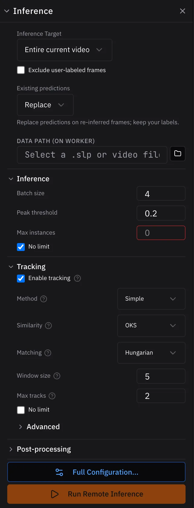
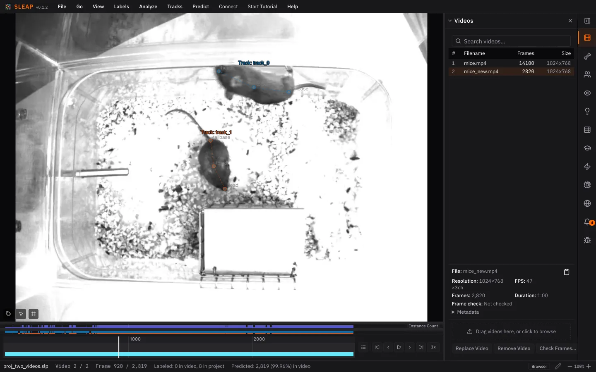

# 6. Tracking a new video

A trained model is most useful on videos you haven't labeled. Run it on a new
video of the same mice, and link each mouse's poses across frames into a
**track** so you know which mouse is which.

## Add the new video

1. Download
   [`mice_new.mp4`](https://github.com/talmolab/sleap-tutorial-data/raw/main/new_data/mice_new.mp4)
   (5 MB, one minute) from the tutorial data.
2. In the **Videos** panel, drag it onto the dropzone (or click the dropzone to
   browse), then click **Import**.
3. Click `mice_new.mp4` in the list to switch to it.

The model learned from `mice.mp4`; this video is from the same setup.

## Run inference with tracking

{ width="280" align=right }

1. Open the **Inference** panel. On the desktop, your latest trained models are
   already picked.
2. Set **Inference Target** to **Entire current video**.
3. Check **Enable tracking** and keep **Method: Simple**. Under **Max tracks**,
   uncheck **No limit** and set it to 2, one per mouse.
4. Click **Run Inference**.

When it finishes, play or scrub through the video. Each mouse gets its own
track, and the bars above the seekbar show where each track is present.

!!! tip "Short on time? Use the pretrained models"

    The tutorial data includes two trained models in
    [`new_data/models`](https://github.com/talmolab/sleap-tutorial-data/tree/main/new_data/models):
    a centroid and a centered-instance model. Download both folders and, in the
    desktop app, add each with **Add** in the **Models** section, then run
    inference the same way. They were trained in an older version of SLEAP;
    sleap-nn runs them as they are.

See [Inference](../guides/inference.md#tracking) for how tracking works and
what each setting does.

*Next up: [Proofreading](proofreading.md)*
