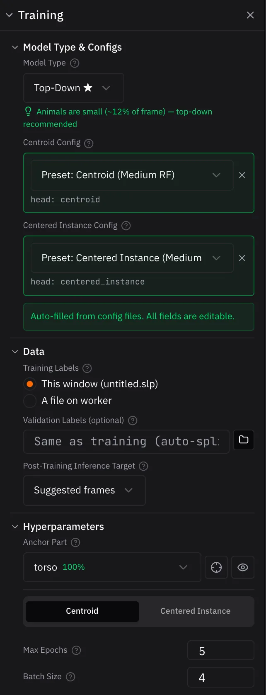

# 4. Training a model

Training teaches a model to find your skeleton's nodes from the frames you
labeled. With one labeled frame this first model won't be accurate, and that's
fine. Early on, a fast model beats an accurate one: all it has to do is make
correcting its predictions quicker than labeling from scratch. Accuracy improves
quickly as you add labels.

Open the **Training** panel and check these settings:

| Setting | Value | Why |
|---|---|---|
| **Model Type** | Top-Down | Finds each animal by its anchor, then the rest of its nodes[^topdown] |
| **Anchor Part** | `torso` | Central and visible in most frames[^anchor] |
| **Max Epochs** | 5 (both models) | Just enough to see training work[^epoch] |
| **Post-Training Inference Target** | Suggested frames | Gives you predictions to correct in the next step |

{ width="280" align=right }

Then click **Start Training** (**Start Remote Training** on a remote worker).

Top-Down trains two models one after the other, and each gets a progress row.
Click a row to see its loss curves: loss measures how far the model's
predictions are from your labels, so it should go down as training goes on.
When training finishes, the app runs the new model on your suggested frames.

On a GPU this run takes a few minutes. On a CPU it's much slower.

!!! note

    Set **Post-Training Inference Target** before you start. It can't be changed
    while training runs.

!!! tip "For your own videos"

    This camera looks down on the mice, so any orientation is natural. For
    overhead videos like this, set **Rotation Augmentation** to **±180°**: the
    model then sees each labeled frame at random angles, which helps it
    generalize from few labels.[^augment] For side-view cameras, keep it small
    (**±15°**), since an upside-down animal would look unnatural.

See [Training](../guides/training.md) for every setting.

*Next up: [Correcting predictions](correcting-predictions.md)*

[^topdown]: The first model (**centroid**) finds each animal. The second
    (**centered instance**) looks at a crop around each one and finds the rest
    of its nodes. That's why Top-Down shows two config slots and trains twice.

[^anchor]: The crop is centered on the anchor part on every frame, so the anchor
    should be central and almost always visible. Anchoring on a body part gives
    more consistent crops than the animal's center, which can land on different
    body parts from frame to frame.

[^epoch]: An epoch is one pass over your labeled frames. Real projects train for
    many more, and training stops early on its own once it stops improving.

[^augment]: Augmentation makes random variations of your labeled frames, such as
    rotations and scaling, so the model doesn't memorize the exact images.
